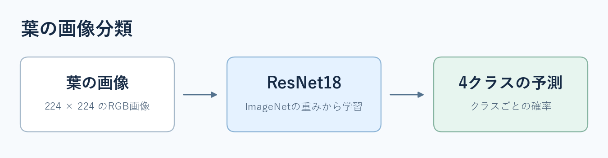

# Plant Pathology 2020 実践演習

ImageNetで学習済みのResNet18を使い、リンゴの葉の画像を4クラスに分類します。基本モデルを動かし、学習・検証・Kaggle提出までを一度通してから、各自の仮説を試します。



| 比較用モデル | Kaggle Private | Kaggle Public |
| --- | ---: | ---: |
| 標準前処理＋ResNet18 | 0.93658 | 0.94415 |
| 追加の画像処理＋ResNet18 | **0.95140** | 0.95217 |

演習の目標は、Kaggleの **Privateスコア0.95140を超えること**です。共通の検証分割で改善案を比較し、採用する条件を決めてから提出します。

## クローン直後のファイル構成

```text
plant-pathology-resnet18-starter/
├── README.md                # 全体像と実行手順
├── requirements.txt         # データ処理に使うPythonパッケージ
├── .gitignore               # データや学習結果をGitの管理対象から外す設定
├── dataset.py               # 画像1枚とラベルまたは画像IDを読み込む
├── data_loading.py          # 学習用・検証用に分け、画像をバッチにまとめる
├── prepare_split.py         # 学習と検証に使う画像の割り当てを作る
├── model.py                 # ResNet18を4クラス分類用に組み替える
├── train.py                 # 学習と検証を行い、最良の重みを保存する
├── evaluate.py              # 保存した重みで検証予測を再現できるか確かめる
├── predict.py               # テスト画像の予測から提出用CSVを作る
├── check_dataset.py         # 画像1枚とラベルを確認する
├── check_dataloader.py      # 画像をまとめたバッチの形を確認する
├── check_model.py           # モデルに画像を渡し、出力の形を確認する
└── docs/
    ├── learning-guide.md    # 参考書に沿った演習の進め方
    └── resnet18.png         # モデルの全体図
```

コードを読むときは `dataset.py` → `data_loading.py` → `model.py` → `train.py` → `predict.py` の順にたどると、画像が読み込まれてから提出用CSVになるまでを追えます。

## 準備

PyTorchとtorchvisionが動く計算機のPython環境を使います。研究室で基本モデルを学習した環境はPython 3.13.11、PyTorch 2.10.0+cu128、torchvision 0.25.0+cu128です。初回の学習ではImageNetの重みをダウンロードします。

残りの依存パッケージが未導入なら、使用中のPython環境でインストールします。

```bash
python -m pip install -r requirements.txt
```

各自でデータを取得して展開し、リポジトリのルートに次の構成で置きます。[コンペのデータ](https://www.kaggle.com/competitions/plant-pathology-2020-fgvc7/data)

```text
data/
  train.csv
  test.csv
  sample_submission.csv
  split.csv             # 配布された共通分割、または prepare_split.py で作成
  images/               # train.csv・test.csv の画像IDに対応するJPEG画像
```

配布された共通の `split.csv` を `data/split.csv` に置きます。手元で動作を試すために分割を作る場合は `python prepare_split.py` を使えます。比較するときは同じ画像IDの割り当てを使います。

## 学習して提出CSVを作る

```bash
python train.py --output-dir outputs/baseline_01
python evaluate.py --run-dir outputs/baseline_01
python predict.py --run-dir outputs/baseline_01
```

初期設定は5エポック、バッチサイズ32、学習率0.0001、乱数シード42です。`train.py` は検証AUCが最も高かった重みを保存します。`evaluate.py` はその重みを読み直して検証予測を照合し、`predict.py` はテスト画像の4クラスの予測確率を `outputs/baseline_01/submission.csv` に保存します。再実行するときは新しい出力名を使います。

3つのコマンドを実行すると、結果が次のようにまとまります。

```text
outputs/baseline_01/
├── best.pt                  # 検証AUCが最良だったときのモデルの重み
├── history.csv              # エポックごとの損失と検証AUC
├── best_metrics.json        # 最良エポックの評価値
├── config.json              # 学習条件と実行環境
├── split.csv                # 学習に使った分割の控え
├── valid_predictions.csv    # 最良エポックの検証画像ごとの予測確率
├── verification.json        # evaluate.py で重みを読み直したときの確認結果
├── submission.csv           # Kaggleに提出するファイル
└── submission.json          # 提出用CSVを作ったときの条件と確認用の記録
```

## 学習ガイド

参考書の章に合わせて実際のコードを読み、小さい確認から順に進めます。[PyTorch学習ガイド（仮版）](docs/learning-guide.md)
