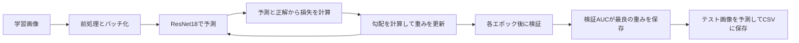

# 画像から分類結果が出るまで

この演習では、正解ラベル付きの葉の画像から、画像の見た目とクラスの対応を学習します。学習後は、同じ前処理とモデルを使って、テスト画像ごとに4クラスの予測確率を求めます。



## 1. 画像と正解をモデルに渡せる形にする

`train.csv` の `image_id` が `Train_0` なら、Datasetは `images/Train_0.jpg` を開きます。正解はCSVの4列から取り出します。たとえば `[0, 0, 0, 1]` なら、`1` がある列の位置からクラス番号 `3`（`scab`）を得ます。各画像に対応するクラス番号は一つで、`multiple_diseases` も4クラスのうちの一つです。[画像とラベルを読み込むコード](../dataset.py)

`get_preprocess()` は、ImageNet学習済み重みに対応する前処理を返します。画像をRGBに揃えてから、短辺を256にリサイズし、中央の224×224を切り出します。画素をテンソルに変換して色チャンネルごとに正規化すると、モデルが想定する形と値の尺度になります。学習・検証・テストに同じ前処理を使います。[前処理のコード](../model.py)・[torchvisionの前処理仕様](https://docs.pytorch.org/vision/0.25/models/generated/torchvision.models.resnet18.html)

DataLoaderは、Datasetから取り出した画像とラベルを、バッチという小さなまとまりにします。`B` はそのバッチの画像数です。[バッチを作るコード](../data_loading.py)

| データ | 形 | 4枚のバッチでの例 |
| --- | --- | --- |
| 前処理後の画像1枚 | `[3, 224, 224]` | 3はRGBのチャンネル数 |
| モデルへの入力 | `[B, 3, 224, 224]` | `[4, 3, 224, 224]` |
| 正解ラベル | `[B]` | `[0, 3, 2, 1]` のような整数の並び |
| モデルの出力 | `[B, 4]` | 画像ごとに4クラスのスコア |

## 2. ResNet18が画像からスコアを作る

CNNの畳み込み層は、小さなフィルタを画像の各位置に当てます。同じフィルタを位置を変えて使うため、似た模様を画像のさまざまな場所で捉えられます。層を重ねると、局所的な模様を組み合わせた特徴を扱えます。ResNetの残差ブロックは、畳み込みで得た値にショートカット側の値を足して次の層へ渡します。[ResNetの原論文](https://arxiv.org/abs/1512.03385)

ResNet18は畳み込みで得た特徴を平均プーリングでまとめ、画像1枚を512個の数値で表します。最後の全結合層は、その512個をクラスごとに重み付きで足し合わせ、バイアスを加えてスコアを出します。softmaxをかける前のこのスコアを **logit** と呼びます。[モデルの実装](https://github.com/pytorch/vision/blob/v0.25.0/torchvision/models/resnet.py)

`build_model()` は、ImageNetで学習した重みを読み込み、最後の全結合層を `Linear(512, 4)` に置き換えます。学習済みの画像特徴を出発点とし、新しい分類層と特徴を抽出する層の両方を、葉画像で追加学習します。この使い方を**ファインチューニング**と呼びます。[分類層を置き換えるコード](../model.py)

## 3. 予測と正解から重みを更新する

たとえば正解が `scab`（番号 `3`）の画像について、モデルが `[0.0, 0.0, 0.0, 2.0]` を出したとします。softmaxをかけると `scab` の予測確率は約0.71です。`CrossEntropyLoss` はlogitと正解番号を受け取り、正解クラスの確率 $p$ に対して1枚あたり $-\log p$ に相当する損失を計算します。正解に割り当てた確率が高いほど、損失は小さくなります。学習コードでは、logitをそのまま損失関数に渡します。[CrossEntropyLossの仕様](https://docs.pytorch.org/docs/stable/generated/torch.nn.CrossEntropyLoss.html)

`train_one_epoch()` の中心は、バッチごとに繰り返す次の5行です。[学習ループ](../train.py)

```python
optimizer.zero_grad()
logits = model(images)
loss = criterion(logits, labels)
loss.backward()
optimizer.step()
```

| 行 | 何が起きるか |
| --- | --- |
| `optimizer.zero_grad()` | PyTorchは勾配を加算するため、前のバッチの勾配を消してから始める |
| `model(images)` | 今の重みで順伝播し、各画像の4クラスのlogitを求める |
| `criterion(logits, labels)` | バッチの予測と正解から、平均損失を求める |
| `loss.backward()` | 逆伝播し、各重みを少し変えると損失がどう変わるかを表す勾配を求める |
| `optimizer.step()` | Adamが勾配を使い、学習率に従って重みを更新する |

学習用データを1周する単位が **1エポック** です。各エポックでは学習用の画像の順番を混ぜ、バッチごとに予測と更新を行います。`backward()` は勾配を求め、実際に重みを変えるのは `step()` です。[PyTorchの学習ループ解説](https://docs.pytorch.org/tutorials/beginner/basics/optimization_tutorial.html)

## 4. 検証データで保存する重みを選ぶ

`split.csv` で、ラベル付き画像を学習用と検証用に分けます。学習用は重みの更新に、検証用は各エポックの評価に使います。同じ分割を使えば、手法を変えた前後で同じ画像に対する結果を比べられます。[分割を読み込むコード](../data_loading.py)

検証では `model.eval()` でBatchNormなどを推論時の動作に切り替え、`torch.no_grad()` で勾配の記録を止めて予測します。`rust` のAUCを計算するときは、正解が `rust` の画像を正例、他クラスの画像を負例にして、モデルの `rust` 列の確率を使います。AUCは、正例が負例より高いスコアを得ているかを測ります。全検証画像をまとめてクラスごとにAUCを計算し、4クラスを等しい重みで平均します。[ROC AUCの仕様](https://scikit-learn.org/stable/modules/generated/sklearn.metrics.roc_auc_score.html)

損失はバッチごとの**重みの更新**に使い、検証AUCはエポックごとの**重みの選択**に使います。検証AUCがこれまでの最高値を超えた時点で `best.pt` を保存します。`evaluate.py` は保存した重みを読み直し、同じ検証画像で得た確率を学習時の記録と照合します。[重みを選ぶコード](../train.py)・[再読み込みを確認するコード](../evaluate.py)

## 5. 保存した重みでテスト画像を予測する

`predict.py` は `best.pt` からモデルの重みを読み込み、テスト画像に学習時と同じ前処理を適用します。各画像のlogitに `torch.softmax(logits, dim=1)` をかけると、4クラスの確率が得られ、画像1枚ごとの合計は1になります。クラス名を一つ表示するなら最大値の列を使えます。Kaggle提出にはクラスごとの順位付けに使う4列の確率を残します。[予測と提出CSVを作るコード](../predict.py)

テスト用Datasetは画像と一緒に画像IDを返します。`predict.py` はそのIDで予測を提出見本に結合し、行順と列順を見本に揃えます。Kaggleでの採点は、テスト画像に対して行われます。手元の検証AUCは保存モデルを選ぶための指標として、KaggleのPublic・Privateスコアと分けて記録します。

## コードで確かめる

| 操作 | 確かめること |
| --- | --- |
| `python check_dataloader.py` | 画像とラベルの先頭の次元が、バッチの枚数と一致する |
| `python check_model.py` | 4枚を入れると `[4, 4]` の出力が得られ、softmax後は各行の合計が1になる |
| `python train.py --epochs 1 --output-dir outputs/first_run` | 学習と検証を1周すると `history.csv` と `best.pt` ができる |
| `python evaluate.py --run-dir outputs/first_run` | 保存モデルで同じ検証予測を再現できる |

参考書と並行して進める順番は、演習ガイドに載せています。[PyTorch学習ガイド](learning-guide.md)
