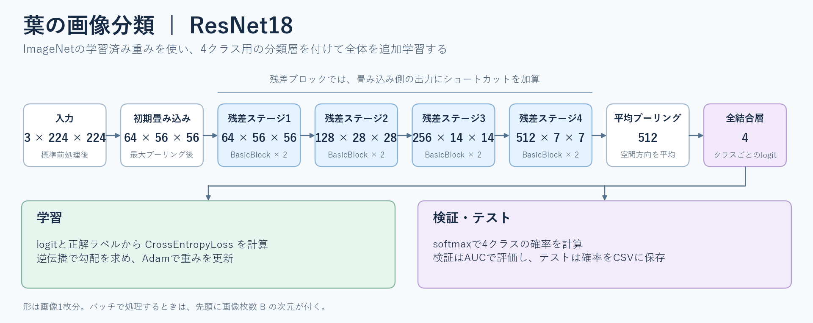

# 参考書と進めるPyTorch・Kaggle演習（仮版）

赤石雅典『最短コースでわかる PyTorch ＆深層学習プログラミング』（日経BP、ISBN 9784296110322）の章立てに合わせた演習です。Python・NumPy・Pandasの基礎と機械学習の基本を学習済みの人を想定しています。各段階で本を読み、該当するコードを動かし、表の「確認すること」を自分の言葉で説明してから進みます。[出版社の目次](https://bookplus.nikkei.com/atcl/catalog/21/283980/)

| 順番 | 参考書 | このリポジトリで行うこと | 確認すること |
| --- | --- | --- | --- |
| 1 | 第2章。第1章は必要な箇所を復習 | `check_dataset.py` で画像1枚とラベルを表示する | 画像の形は `[3, 224, 224]`。RGBの3チャンネルを持つ |
| 2 | 第3〜4章、第7章 | `train.py` の `train_one_epoch` を読んで、予測・損失・逆伝播・更新を追う | 4つのlogitと正解クラス番号から損失を計算する |
| 3 | 第8〜9章 | `check_dataloader.py` で画像をまとめ、モデル図でCNNの出力を追う | 入力は `[B, 3, 224, 224]`。ResNet18が最後に使う特徴は画像1枚あたり512個 |
| 4 | 第11章 | `model.py` で分類層を読み、`check_model.py` を実行する | 512個の特徴を4クラスのlogitへ変換する |
| 5 | 第12章 | `dataset.py` と `data_loading.py` を読み、1エポックだけ学習する | 画像ID・画像・ラベルが対応し、学習と検証の画像が分かれている |
| 6 | 第12章の応用 | 5エポック学習し、保存重みの確認とKaggle用の予測を行う | 検証AUCで重みを選び、テスト画像ごとに4クラスの確率を提出する |
| 7 | 第10章 | 基本モデルの結果を保存してから改善案を一つ試す | 何を揃え、何を変え、どの指標で比較したかを説明できる |

序章は画像認識の全体像をつかむとき、第5〜6章は予測や損失の考え方を復習したいときに参照してください。

## 1枚から1バッチへ

`dataset.py` の `PlantDataset.__getitem__` は、画像IDから画像を読み込み、前処理を適用し、画像とクラス番号を返します。`PlantTestDataset` は、テスト画像とCSVでの照合に使う画像IDを返します。`data_loading.py` は `split.csv` に従って学習と検証を分け、それぞれをDataLoaderに渡します。

```bash
python check_dataset.py
python check_dataloader.py
```

最初のコマンドは画像1枚ずつ、次のコマンドは4枚のバッチを表示します。画像 `[4, 3, 224, 224]` とラベル `[4]` の先頭の次元が、どちらもバッチ内の画像数であることを確認してください。

## 画像から4つのスコアへ



`model.py` の `get_preprocess` が、短辺を256にリサイズし、中央224×224を切り出して、テンソル化と正規化を行います。`build_model` はImageNet学習済みResNet18を読み込み、最後の層を `Linear(512, 4)` に置き換えます。演習ではResNet18全体を更新します。モデル確認用のコマンドはダウンロードなしで入出力の形を確かめられます。[torchvisionのResNet18](https://docs.pytorch.org/vision/0.25/models/generated/torchvision.models.resnet18.html)

```bash
python check_model.py
```

4枚を入れたときの出力 `[4, 4]` では、行が画像、列がクラスです。4列の順番は `dataset.py` の `CLASS_NAMES` で確認できます。

## 1エポックだけ学習する

```bash
python train.py --epochs 1 --output-dir outputs/first_run
```

`train.py` の `train_one_epoch` で `zero_grad`、予測、損失、`backward`、`step` の順を追います。`CrossEntropyLoss` に渡すのはsoftmax前のlogitです。`validate` は保存するエポックを選ぶため、4クラスそれぞれのROC AUCとその平均を計算します。

`outputs/first_run/history.csv` を開き、学習損失と検証AUCの列を確認します。`best.pt` が作成されたら、READMEに従って基本モデルの5エポック学習、検証、予測を行います。[学習・予測コマンド](../README.md#学習して提出csvを作る)

## 改善案を一つ試す

画像や検証結果を観察し、変更する条件を一つ選びます。同じ学習・検証分割で基本モデルと比較し、平均AUCとクラス別AUCの両方を記録します。選んだモデルをKaggleに提出し、PublicとPrivateを別々に記録します。

| 報告項目 | 記入する内容 |
| --- | --- |
| 仮説 | 画像や予測結果を見て、どこを改善できると考えたか |
| 実験条件 | 変えた条件、共通にした条件、実行したコードの版 |
| 検証結果 | 共通分割の平均AUC、クラス別AUC、基本モデルとの差 |
| Kaggle結果 | PublicとPrivateの各スコア |
| 考察 | 結果が仮説と合っていたか、次に確かめたいこと |
